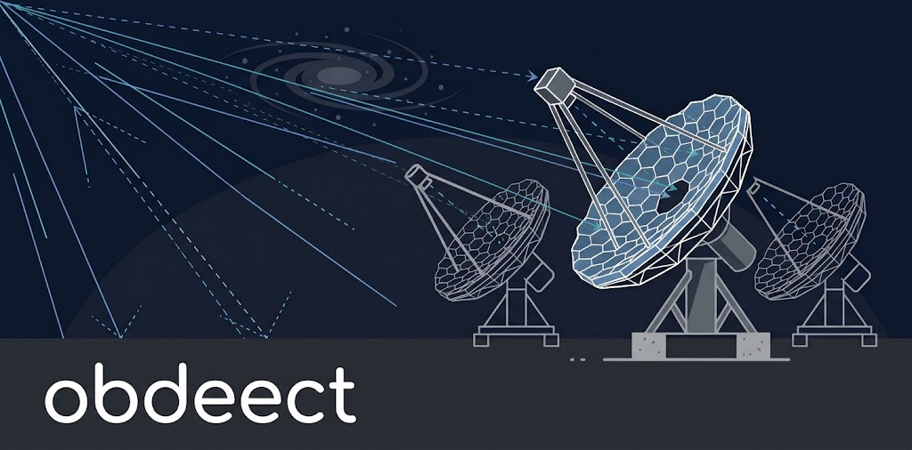

# obdeect

<p align="center">
  
</p>

`obdeect` is a C++20 optical ray tracer for imaging atmospheric Cherenkov
telescopes. The C++ core uses only the standard library. Python compiles
optical models from the simulation models, traces photons, and plots results;
simtools uses it as a ray-tracing backend.

See the [user guide](docs/USER_GUIDE.md), the [physics](docs/PHYSICS.md) of the
photon path, and the [validation](docs/VALIDATION.md) against sim_telarray.

## User Installation

Install from PyPI with:

```sh
python -m venv .venv
source .venv/bin/activate
python -m pip install obdeect-dev
```

(requires python 3.14 or higher)

Verify the installation by compiling an optical model from a
[simulation-models](https://gitlab.cta-observatory.org/cta-science/simulations/simulation-model/simulation-models)
checkout and tracing a star:

```sh
obdeect compile --simulation-models ../simulation-models --model MSTN-01 \
  --version 7.0.0 --seed 1 --zenith-deg 20 --output mst.json
obdeect trace --model mst.json --seed 2 --photons 10000 --field-deg 0.5 0
```

## Developer Installation

```sh
python -m venv .venv
source .venv/bin/activate
python -m pip install -e '.[dev]'
cmake --preset debug
cmake --build --preset debug --target clean  # optional: clean the build directory before building
cmake --build --preset debug
```

The C++ tests are in `build/debug/tests/`.

Test your installation with:

```sh
ctest --test-dir build/debug --output-on-failure
python -m pytest python/tests
```

## License and Citation

BSD-3-Clause license. Citation metadata is in [CITATION.cff](CITATION.cff).

## Generative AI disclosure

Generative AI tools (mostly ChatGPT 5.6) were used to write the entire code of this project. All AI-assisted outputs were reviewed, validated, and, where necessary, modified by the authors to ensure accuracy and reliability.
