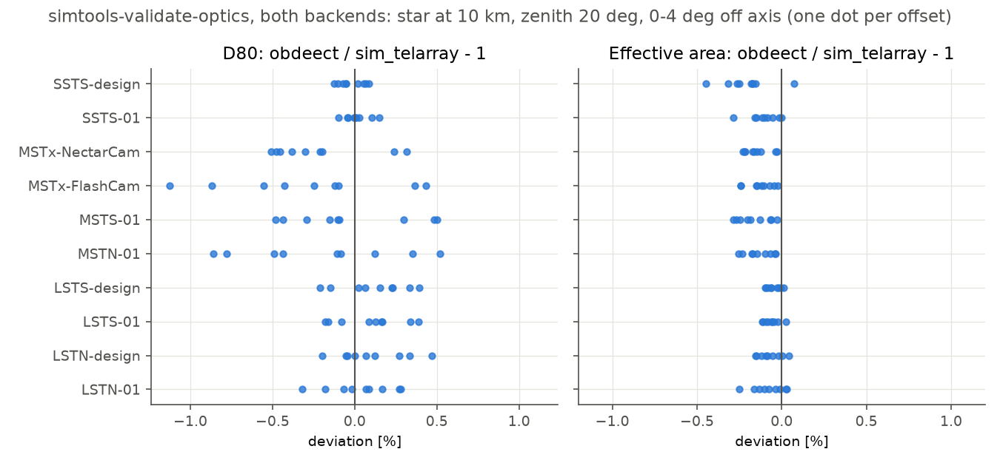

# obdeect

obdeect traces photons through the optics of imaging atmospheric Cherenkov
telescopes: from the sky, a light source or a shower photon bunch, over the
mirrors, past the telescope structure, to the camera entrance. It is a C++20
library with a Python interface and a command line. The telescope is described
by an **optical model**: one JSON document compiled from the CTAO simulation
models (simulation-models repository), with the provenance of every parameter and file it was made from.

obdeect reproduces the optical part of sim_telarray and is one of the two
ray-tracing backends of [simtools](https://github.com/gammasim/simtools)
(`--ray_tracing_backend obdeect`). It is validated against sim_telarray for
every CTAO telescope type: point-spread function, effective area, focal
length, incidence angles, flashers and illuminators.



```{toctree}
:maxdepth: 2
:caption: User guide

USER_GUIDE
shadowing
```

```{toctree}
:maxdepth: 2
:caption: Physics and validation

PHYSICS
limitations
VALIDATION
```

```{toctree}
:maxdepth: 1
:caption: Reference

api
```
