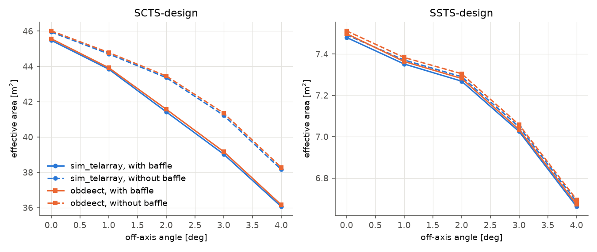

# Validation

Validation proceeds from analytic kernels to optical-model compilation and
comparisons with sim_telarray:

1. **Kernels and primitives** (`cpp/tests`): random numbers (Philox known
   answers), tables, apertures, facet grid against brute force, polynomial
   surfaces against brute force, obscurers, sources, transmission; traced
   photons in analytic optics; model loading and its error messages.
2. **Compilation** (`python/tests`): parameter records to optical models —
   Davies-Cotton geometry, seeded mirror errors, focus offsets, camera body,
   dual-mirror surfaces, telescope structure, unit handling, store and reload.
3. **Equivalence with sim_telarray** (below): the same simtools applications
   run with both backends on the same simulation models.


## How to repeat the comparison

In a simtools environment with sim_telarray and obdeect installed, for each
telescope and backend:

```sh
simtools-validate-optics --site North --telescope LSTN-01 --model_version 6.0.2 \
  --zenith_angle 20 --source_distance 10 --max_offset 4 --offset_step 1 \
  --offset_directions N,E --ray_tracing_backend obdeect \
  --instrument_seed 11 --simulation_seed 11 --output_path out/LSTN-01/obdeect
```

and the same with `--ray_tracing_backend sim_telarray`, then compare the
`results/ray_tracing_*.ecsv` tables (D80, effective area, effective focal
length per offset). Incident angles: `simtools-derive-incident-angle` with both
backends. Both backends draw 20 mirror-error realisations of 100,000 photons per
offset (2 million photons), so random mirror errors and photon statistics
limit the agreement; repeating with other seeds shows the spread.

## Results (simulation models 6.0.2, zenith 20 deg, star at 10 km, 0-4 deg)

obdeect at commit 7394e73 (after the performance rounds), simtools at commit
fcd73f6033 (`--instrument_seed 11 --simulation_seed 11`). Largest deviation
of obdeect from sim_telarray over nine offsets:

| Telescope | D80 | Effective area | Effective focal length |
| --- | --- | --- | --- |
| LSTN-01 | 0.6% | 0.10% | 0.01% |
| MSTN-01 (NectarCam) | 1.6% | 0.07% | 0.05% (realisation spread) |
| MSTS-01 (FlashCam) | 1.6% | 0.07% | 0.05% (realisation spread) |
| SSTS-01 | 0.14% | 0.28% | < 0.01% |
| SCTS-01 (one-pixel camera) | 0.15% | 0.29% | < 0.01% |
| LSTS-01 | 0.6% | 0.10% | 0.01% |
| LSTN-design | 0.5% | 0.10% | 0.01% |
| LSTS-design | 0.6% | 0.10% | 0.01% |
| MSTx-FlashCam | 1.6% | 0.07% | 0.05% (realisation spread) |
| MSTx-NectarCam | 1.6% | 0.07% | 0.05% (realisation spread) |
| SSTS-design | 0.14% | 0.28% | < 0.01% |
| SCTS-design (one-pixel camera) | 0.12% | 0.22% | < 0.01% |

- The D80 deviations of the single-mirror telescopes come from the random
  mirror errors: each backend draws its own realisations. An earlier run with
  other seeds (simtools option `--obdeect_seed`) gave 0.3-1.1%;
  between the two seed sets sim_telarray's own D80 changes by up to 1.3%
  (MSTN-01) and obdeect's by up to 1.0%. The telescopes of one type share the
  optics and the seeds, hence the same largest deviations.
- obdeect 0.3.0 and 7394e73, same simtools and seeds: LSTN-01 and MSTS-01
  identical (D80 and focal length to 1e-15, the rounding of simtools' analysis);
  SSTS-01 and SCTS-design within 3e-9 (D80) and 8e-11 (focal length), the
  rounding-level changes below; effective areas identical.
- The SCT rows compare with sim_telarray photon lists of a one-pixel camera
  (the container's sim_telarray build allows at most 2368 pixels; scripts
  `val/sct_simtel.sh`, `val/sct_design_simtel.sh`).

- Star at 10,000 km (LSTN-01, 0-2 deg): D80 within 0.15%, area within 0.13%.
- Per mirror (MSTN-01, on axis, 86 mirrors): the fractions of photons
  reflected by each mirror agree within statistics (pulls: mean 0.05,
  standard deviation 0.96), including the mirrors partly shadowed by the camera.
- Single-mirror mode (29 MSTN-01 mirrors): mean D80 1.503 cm for both, spread
  0.183 cm (sim_telarray) and 0.160 cm (obdeect).
- Incident angles (SSTS-01, 1 deg, 10^6 photons, per photon): mean angles on
  the focal surface 46.656/46.658 deg, primary 9.899/9.898 deg, secondary
  33.184/33.183 deg; in bins of the primary radius they agree within 0.05 deg.
  LSTN-01 focal surface: 15.81/15.80 deg.
- Frames: image centroids of off-axis stars agree in sign and size (LSTN-01,
  2 deg: -102.42 and -102.40 cm) without any frame conversion.

The PSF applications, LSTN-01, measured PSF curves of the simtools test
resources:

| Application | sim_telarray | obdeect |
| --- | --- | --- |
| `validate-cumulative-psf` (6.0.2, 20 deg, 7394e73) | D80 3.052 cm, area 365.7 m², 46 s | D80 3.050 cm, area 365.8 m², 3 s |
| `derive-psf-parameters` (6.0.2, 20 deg) | RMSD 0.0131, D80 3.053 cm | RMSD 0.0127, D80 3.059 cm |
| `derive-mirror-rnda` (7.0.0, test mode, 5 mirrors) | fitted D80 within 0.9-3.8% of measured, 117 s | within 0.8-4.9%, 19 s |
| `derive-mirror-rnda` (7.0.0, full statistics) | first 20 mirrors: within 4.2% (median 1.7%), 848 s | all 198 mirrors: within 5% (median 2.4%), 241 s |

The `derive-psf-parameters` and `derive-mirror-rnda` rows are from an earlier
obdeect version and were not rerun; the PSF they use is checked above.
Both backends start `derive-psf-parameters` below its RMSD threshold, so the
optimisation stops at once. Its final D80-versus-offset plot (46 offsets in four
directions, 2 million photons each) needed more than 2 GB of memory with either
backend, because simtools kept every photon image (fixed in simtools#2664): at
full statistics it takes 2120 s with sim_telarray (RMSD 0.0132 to 0.0101 in
one step, peak 0.3 GB) and 115 s with obdeect (0.0127 to 0.0107, peak 1.45
GB); in `--test` mode the whole application takes 11 s
(sim_telarray) and 6 s (obdeect). With 5000 photons per evaluation the
`derive-mirror-rnda` fits differ by their noise; with a fixed `--simulation_seed`
every evaluation reuses the same photons, so the obdeect objective is smooth.
On the 20 mirrors fitted by both, the fitted random reflection angle of obdeect
is 2.8% below sim_telarray's on average, with a spread of 6.6% between mirrors
(fit noise). These sim_telarray fits used `--max_workers 1`: parallel mirror
jobs shared one model directory and rewrote its files, including the trial
random reflection angle, while others read them (fixed in simtools#2666).

The comparison found and fixed one convention: sim_telarray measures the
distance of a point source from the dish vertex, not from the telescope frame
origin (0.02% plate-scale difference for the SCT at 10 km).

## Telescope structure (beyond sim_telarray)

`telescope_transmission` is sim_telarray's fit of the ratio of the effective
mirror area of a detailed ray tracing (with masts) to its own (camera body
only), versus the off-axis angle. The same ratio from obdeect, the same photons
traced with and without the structure (geometry only, mean of four azimuths),
for MSTx-FlashCam (`telescope_structure` 1.0.0 on simulation-models branch
`simulation-model-masts`):

| Off axis | 0 deg | 1 deg | 2 deg | 3 deg | 4 deg |
| --- | --- | --- | --- | --- | --- |
| obdeect structure | 0.8945 | 0.8917 | 0.8897 | 0.8866 | 0.8855 |
| `telescope_transmission` 2.0.0 | 0.8980 | 0.8967 | 0.8939 | 0.8898 | 0.8846 |

`simtools-validate-optics` for MSTS-01 (production 7.0.0, both backends)
agrees in effective area within 0.4% on axis and 1.2% up to 4 deg; obdeect
shows the azimuthal dependence (up to 2% between N and E) that the radial
parameterisation cannot. The structure also widens D80 by 1.4% on axis (same
photons with and without structure), since it shades the dish unevenly.

## Secondary baffles

`simtools-validate-optics` (simulation models 7.0.0, zenith 20 deg, star at
10 km, offsets towards N, seeds 11) with both backends, once as modelled and
once with the baffle removed (`secondary_mirror_baffle` R1 = 0; sim_telarray
keyword `secondary_baffle`). The container's sim_telarray build allows at most
2368 pixels, so its SCT runs use a one-pixel camera. Scripts:
`val/baffle/run_baffle.sh` and `with_changes.py` (obdeect-validation).



Effective area with the baffle divided by that without it:

| Off axis | SSTS-design sim_telarray | obdeect | SCTS-design sim_telarray | obdeect |
| --- | --- | --- | --- | --- |
| 0 deg | 0.9983 | 0.9982 | 0.9898 | 0.9903 |
| 1 deg | 0.9974 | 0.9974 | 0.9807 | 0.9808 |
| 2 deg | 0.9970 | 0.9969 | 0.9553 | 0.9567 |
| 3 deg | 0.9968 | 0.9967 | 0.9465 | 0.9471 |
| 4 deg | 0.9965 | 0.9966 | 0.9450 | 0.9447 |

Both codes lose the same light on the baffles: within 0.01% for the SST and
0.14% for the SCT, where the baffle costs up to 5.5%. The SST baffle costs
little because most light meeting it would also meet the secondary shadow
plate (see [shadowing](shadowing.md)). The effective areas themselves agree
within 0.36% (obdeect higher, with and without baffle).

## Calibration light (Phase 2)

`simtools-simulate-flasher --run_mode full_simulation` and
`simtools-simulate-illuminator`, both backends, simulation models 7.0.0:

- sim_telarray backend: `ff-1m` or `xyzls` make the light, sim_telarray traces it
  through its optics and simulates the camera;
- obdeect backend: obdeect makes and traces the light to the camera entrance,
  simtools writes the photons as photon bunches, sim_telarray simulates the
  camera with its optics bypassed (`Bypass_Optics=1` single mirror,
  `Bypass_Optics=2` dual mirror).

Each case runs with both backends and two seed sets (`--instrument_seed 11` and
`12`, `--simulation_seed 111` and `112`); the two seed sets of one backend give
the run-to-run scatter each comparison is judged against. Compared: photoelectrons
per event, image centre and width, time spread of the photoelectrons, and per
pixel the summed images scaled to the same total, (b - a) / sqrt(a + b), whose
spread is 1 for Poisson fluctuations only ("shape pull"). Flashers: 100 pulses;
illuminators: 10 pulses of 10^9 photons.

| Case | p.e./event sim_telarray | p.e./event obdeect | obdeect / sim_telarray | centre shift [mm] | width ratio | time rms [ns] sim_telarray / obdeect | shape pull, cross / same backend | wall time [s] sim_telarray / obdeect |
| --- | --- | --- | --- | --- | --- | --- | --- | --- |
| Flasher LSFN-design, LSTN-01 | 665228 | 665272 | 1.0001 ± 0.0001 | 0.1 | 1.0000 | 0.60 / 0.60 | 1.01 / 12.2 | 512 / 397 |
| Flasher LSFS-design, LSTS-01 | 669651 | 666603 | 0.9954 ± 0.0001 (a) | 0.0 | 1.0001 | 0.60 / 0.60 | 1.00 / 12.3 | 508 / 385 |
| Flasher MSFx-FlashCam, MSTS-04 | 38923 | 38914 | 0.9998 ± 0.0005 | 0.2 | 0.9999 | 0.72 / 0.72 | 0.99 / 1.93 | 76 / 59 |
| Flasher MSFx-NectarCam, MSTN-07 | 18639 | 18598 | 0.9978 ± 0.0007 (a) | 0.2 | 1.0007 | 1.07 / 1.07 | 1.00 / 1.45 | 43 / 35 |
| ILLN-01 to MSTN-07 (415 m, elevation 10 deg) | 7911 | 7884 | 0.9967 ± 0.0036 | 0.4 | 1.0046 | 0.73 / 0.75 | 7.8 / 7.8 (b) | 135 / 5 |
| ILLN-02 to LSTN-01 (797 m) | 5706 | 5668 | 0.9934 ± 0.0035 | 1.9 | 1.0002 | 0.08 / 0.08 | 1.39 / 1.66 | 15 / 6 |
| LSTN-01, source 2.0 deg off axis at 600 m (camera rotated) | 5838 | 5826 | 0.9981 ± 0.0040 | 1.6 | 1.0004 | 0.10 / 0.10 | 1.42 / 1.68 | 21 / 6 |
| ILLS-03 to MSTS-07 (638 m, elevation 3.6 deg) | 3340 | 3330 | 0.9969 ± 0.0054 | 0.7 | 1.026 | 1.35 / 0.71 (c) | 7.8 / 7.7 (b) | 67 / 6 |
| ILLS-03 to LSTS-04 (929 m, elevation 2.3 deg) | 3750 | 3773 | 1.0062 ± 0.0062 | 8.7 (c) | 1.0016 | 10.5 / 0.07 (c) | 1.51 / 1.63 | 16 / 5 |
| ILLS-03 to SSTS-17 (79 m), 300 nm | 6903 | 12051 | 1.7458 ± 0.0048 (d) | 0.2 | 1.0002 | 0.08 / 0.01 (c) | 1.03 / 1.33 | 658 / 10 |
| ILLS-03 to SSTS-17, 400 nm | 22702 | 24840 | 1.0942 ± 0.0018 (d) | 0.1 | 1.0004 | 0.08 / 0.01 (c) | 0.99 / 1.54 | 647 / 9 |
| SSTS-17, source 1.7 deg off axis at 400 m | 251 | 452 | 1.80 ± 0.03 (d) | 0.1 | 1.005 | 0.02 / 0.00 | 0.91 / 0.84 | 504 / 6 |

- Flashers and pixels: with the same seeds, obdeect and sim_telarray agree per
  pixel at the Poisson level (shape pull 0.97-1.01) in all four flasher cases;
  other seeds change the pixel efficiencies of the camera simulation, which
  dominates the run-to-run scatter (1.4-12).
- (a) The camera is at `focal_length + focus_offset` from the dish; simtools
  placed `ff-1m` at `focal_length`, which gave 0.3-0.5% more light (predicted
  (2800 / 2806.55)^2 = 0.9953 for the LSTs, measured 0.9954). simtools now
  places the flasher at the camera (simtools#2667); the LSTN-01 and MSTS-04 rows
  are rerun with it and agree within 0.02%.
- (b) Random mirror errors: each realisation shapes the defocused image of a
  source at a few hundred metres; obdeect and sim_telarray draw different
  realisations, as do two seeds of one backend, so all pairs differ by the same
  7-8 times Poisson.
- (c) `xyzls` hands the light over at the horizontal plane through the
  telescope's fiducial sphere and applies CORSIKA's refraction and delay model,
  made for light from above. For nearly horizontal light the bunch times
  deviate from the straight flight from the source: by 0.02 ns rms at 10 deg
  elevation, 1.6 ns rms (up to -4.5 ns) at 3.6 deg and 11 ns rms (up to -35 ns)
  at 2.3 deg, for bunches handed over 100-1000 m in front of the telescope.
  sim_telarray's photoelectron times inherit this, at 2.3 deg also its image
  centre (8.7 mm, 64 arcsec; refraction over 929 m bends the light by about 3
  arcsec) and its readout charge. obdeect's times follow the geometry; the
  SST optics are isochronous to 0.01 ns.
- (d) sim_telarray reflectivity for 2-D (wavelength, incidence angle) tables:
  it applies R(lambda, 0) R(lambda, theta) / R_max(lambda) instead of
  R(lambda, theta) (see [Optics](optics.md)). The SST mirrors have such
  tables; predicted ratios 1.7449 (300 nm) and 1.0943 (400 nm), measured
  1.7458 +- 0.0048 and 1.0942 +- 0.0018. Image centres and shapes agree. For
  Cherenkov light this bug makes sim_telarray's SSTs about 9% too dim at 400 nm.
- The photon bunch file: the bunches of an `ff-1m` file, written again by
  simtools, give an identical sim_telarray output (photoelectrons of every
  pixel).

The scripts are in the validation workspace (`val/phase2`: `cases.sh`,
`run_case.sh`, `compare.py`, `summarize.py`, `xyzls_times.py`).

## Single-core speed

Both codes pinned to one core of the validation container (aarch64 Linux VM,
Apple silicon host; obdeect Release build), simulation models 7.0.0, the same
telescope models and photon numbers. Per-photon costs are the slope between
2*10^5 and 2*10^6 photons (best of three runs), which removes start-up:
sim_telarray 0.01-0.09 s, obdeect model compilation 0.17-0.28 s. obdeect at
commit 7394e73; best of two such runs (LSTN-01: four) on a host that was
partly busy, which also slowed sim_telarray by up to 7% against earlier runs.

Star light (zenith 20 deg, star on axis at 10 km, photons sampled on the
entrance disk), microseconds per photon:

| Telescope | sim_telarray as simtools runs it (imaging list) | sim_telarray, no imaging list | obdeect sampling + tracing | obdeect tracing only |
| --- | --- | --- | --- | --- |
| LSTN-01 | 1.86 | 0.33 | 0.34 | 0.26 |
| MSTN-07 | 1.68 | 0.31 | 0.31 | 0.24 |
| MSTS-04 (with `telescope_structure`) | 1.69 | 0.31 | 0.44 | 0.36 |
| SSTS-17 | 1.29 | 0.30 | 0.58 | 0.50 |

- Per core, obdeect samples and traces single-mirror telescopes as fast as
  sim_telarray without its imaging list; the applications gain from writing no
  photon lists (sim_telarray spends 80% of its time on them) and from using
  every core. The earlier factors of 6-18 (Phase 1, whole applications, wall
  time) combine both, they are not per-core speed. The dual-mirror and
  structure cases are still slower per core than sim_telarray, which traces
  no structure and loses a photon that meets a gap between segments.
- The telescope structure (203 elements) is searched through a grid of the
  structure in the horizontal plane for steep rays and a bounding-box
  hierarchy for the others; its cost fell from 0.79 to 0.39 us per photon.
- Aspheres (SST, SCT): a ray that crosses the surface at most once ends its
  search at the first root or when the surface is missed, the segment under a
  hit point is found from a grid, and a Newton step evaluates the surface once
  (SSTS-17: 1.28 to 0.61 us per photon). Facet mirrors use tighter grid cells
  and a plane test before the sphere test (LSTN-01: 0.33 to 0.25 us). All
  results are bit-identical to the earlier ones.
- Aspheres evaluated in r^2 and a better first Newton guess (rounding-level
  changes, below): SSTS-17 tracing 0.61 to 0.50 us per photon. Single-mirror
  telescopes are unchanged (interleaved runs of LSTN-01 against the previous
  build agree within the timing noise of 5%).

Calibration light, the stage before sim_telarray's camera simulation (which is
the same for both):

| Case | LightEmission | obdeect making and tracing | writing photon bunches | ratio |
| --- | --- | --- | --- | --- |
| Flasher MSFx-FlashCam on MSTS-04, 10^8 photons, 4.0*10^7 at the camera | `ff-1m` 58.6 s | 23.8 s | 22.1 s | 1.3 |
| Illuminator 600 m above LSTN-01, 10^10 photons, 8.3*10^5 at the camera | `xyzls` 14.7 s | 0.8 s | 0.5 s | 11.8 |

`xyzls` follows every emitted photon; obdeect makes only the photons crossing
the telescope entrance (see [Light sources](light-sources.md#flashers-and-illuminators)), and its cost scales with those.
Scripts: `val/phase2/bench_star.py`, `bench_light.py`.

## Rounding-level changes

These changes alter results in the last bits of floating-point arithmetic. Each
was measured against the state at the start of the round (commit 13daac1, the
reference worktree `ref3`) with a replay of 6 * 10^6 photons per model, the same
seeds, and fixed tier G limits: at most 5 flips per 10^6 photons (a flip is a
photon whose status or any surface id changes), and per field |difference|
at most 1e-8 m for position and path, 1e-9 for direction, 1e-7 ns for time and
1e-9 (relative) for weight.

What changed, and what was measured:

- **Aspheres evaluated in r^2** (SST, SCT): the sag and slope polynomials take
  r^2 instead of r. SSTS-17: max position difference 5.8e-15 m, 0 flips.
  SCTS-design: max position 1.0e-10 m, 0 flips.
- **Order of the first guesses for aspheres**: when the surface can have only
  one intersection with the ray (the single-root rule), Newton starts from the
  paraboloid guess inside the aperture interval instead of the one clamped to
  its edge. A fitted quadric as first guess was tried and gave no further gain.
  Secondary Newton steps for SSTS-17 fell from 4.54 to 2.95 per photon.
  SSTS-17: max position 2.8e-10 m, direction 8.2e-11, 0 flips. SCTS-design: max
  position 1.1e-10 m.
- **Estrin evaluation of the polynomials**: no speed gain, reverted.
- **Facet mirror scatter in closed form**: no speed gain, reverted. The check
  found that on curved facets the facet tangent vectors are not exactly
  perpendicular to the hit normal (up to 1.9e-2 rad). This property is not
  changed by the round.
- **Telescope transmission**: the power of the outer term is skipped when it is
  1, and a 4096-interval table of the transmission was tried. The outer power is
  1 in all models, and the table fails the 1e-8 validation for every model with
  a transmission (max relative table error 1.9e-7 MSTN-07, 6.7e-6 SCTS-design,
  6.5e-4 SSTS-17), so no model uses a table. The replay is bit-identical, and the
  change gave no speed gain: reverted.
- **`OBDEECT_USE_FMA`** (CMake option, default OFF): see the user guide.

Total change of the round (final state against 13daac1, tier G, 6 * 10^6 photons
per model):

| Model | Flips | Max position (m) | Max direction | Max path (m) | Max time (ns) | Max weight (rel.) |
| --- | --- | --- | --- | --- | --- | --- |
| LSTN-01 | 0 | 0 | 0 | 0 | 0 | 0 |
| MSTN-07 | 0 | 0 | 0 | 0 | 0 | 0 |
| MSTS-04 | 0 | 0 | 0 | 0 | 0 | 0 |
| SSTS-17 | 0 | 2.8e-10 | 8.2e-11 | 5.5e-10 | 1.8e-9 | 2.3e-12 |
| SCTS-design | 0 | 1.1e-10 | 1.1e-11 | 3.4e-10 | 1.1e-9 | 0 |

Optics check (container `obdeect-val`, simtools with model version 6.0.2,
seeds 11 and 11): the optics validation of SSTS-01 and MSTS-01 and the
cumulative PSF of LSTN-01, once with the reference build and once with the
final build. Largest relative difference of D80, effective area and centroid
per offset: SSTS-01 3.7e-9 (centroid), MSTS-01 0, LSTN-01 0. The gate of 1e-4
passes. The effective focal length is not deterministic in simtools and is not
gated (SSTS-01: 7.9e-11).
