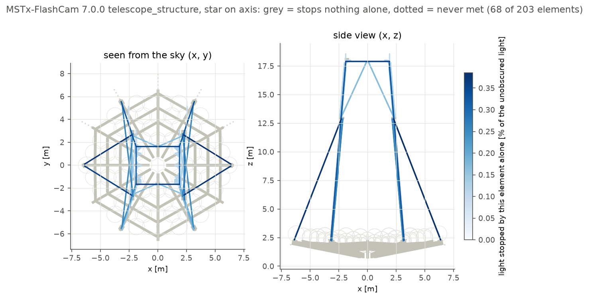

# Shadowing and the telescope structure

Light can be absorbed on its way to the camera by the camera body, the
secondary mirror and its baffle, and, if the model has a `telescope_structure`
table, by the masts, quadrupods and dish frame (see the
[user guide](USER_GUIDE.md#telescope-structure) for the table format). Every
such body is an **obscurer** of the optical model, active on one or more legs
of the photon path: `incoming` (sky to primary), `after_primary` and
`after_secondary`. A photon absorbed by an obscurer has the status `blocked`
and its `terminal_surface` is the obscurer's id.

## Which obscurers matter: `obscurer_hits`

A detailed structure has hundreds of elements; many of them sit behind the
mirrors or in the shadow of others and never stop a photon on their own.
`OpticalModel.obscurer_hits` (command line: `obdeect obscurers`) tells them
apart. It traces the photons once without obscurers and, for each one that
reaches the focal surface, lists every obscurer its path meets. Per obscurer
it returns the light (summed input weights) that

- **crossed** it: the path meets it;
- it absorbs **first**: the light that the full model loses on it;
- it alone stops (**sole**): the path meets no other obscurer, so without this
  element the light would be detected.

Removing an element changes the detected light by exactly its `sole` value
(tested), so elements whose `sole` is zero over all source directions of
interest can be removed without changing the result; elements that are
never `crossed` cost only tracing time. The diagnostic tests every obscurer on
every leg, so it is meant for studies, not for production runs.

```python
from obdeect import OpticalModel

model = OpticalModel.from_simulation_models(root, "MSTx-FlashCam", "7.0.0", configuration_seed=1)
photons = model.star_photons(1_000_000, seed=11)
hits = model.obscurer_hits(photons, seed=12)
share = hits["sole"] / hits["unobscured"]
```

```bash
obdeect obscurers --model mst.json --seed 1 --photons 1000000 --field-deg 2 0
```

## The MST structure



MSTx-FlashCam, simulation models 7.0.0 (`telescope_structure` 1.0.0 on branch
`simulation-model-masts`), star at infinity, 400,000 photons:

| | on axis | 2 deg off axis |
| --- | --- | --- |
| light reaching the camera without obscurers that is absorbed | 16.0% | 16.7% |
| camera body | 6.0% | 6.1% |
| elements of 203 never met | 68 | 68 |
| elements that never absorb first | 73 | 72 |
| elements that never stop light alone | 91 | 86 |

The camera-support masts dominate (each 0.3-0.5%). Over the whole field of
view (on axis and 1-4 deg in eight azimuths, 33 directions, 300,000 photons
each) the largest share per element gives:

| elements of 203 | count |
| --- | --- |
| never met by star light | 68 (all 48 dish-frame plates, 1 dish-frame cylinder, 19 camera-support elements) |
| never stop light alone | 73 |
| stop less than 0.01% alone | 98 |
| stop less than 0.1% alone | 178 |

The dish frame lies behind the mirrors and cannot be reached by light from the
sky. Elements that are never met can be removed from the table without any
change of results for light from within 4 deg of the axis; they cost only
tracing time.
Light that starts inside the telescope (flashers) takes other paths and has to
be checked separately before removal.

## Baffles of the dual-mirror telescopes

The secondary baffle (`secondary_mirror_baffle`) is a cylinder or cone wall
with a radial thickness, active on the incoming and after-primary legs, as in
sim_telarray (`baffle_intersection` in `sim_imaging.c`). The census for
simulation models 7.0.0, on axis and 2 deg off axis:

| | SSTS-design | SCTS-design |
| --- | --- | --- |
| baffle absorbs first | 6.0% / 6.3% | 0.84% / 3.7% |
| baffle alone stops | 0.14% / 0.25% | 0.84% / 3.7% |
| secondary shadow absorbs first | 21.3% / 21.2% | 14.0% / 14.1% |

For the SST, most light meeting the baffle would also meet the secondary
shadow plate; for the SCT, the baffle is the only obscurer on its rays. See
[validation](VALIDATION.md#secondary-baffles) for the comparison with
sim_telarray with and without the baffles.
